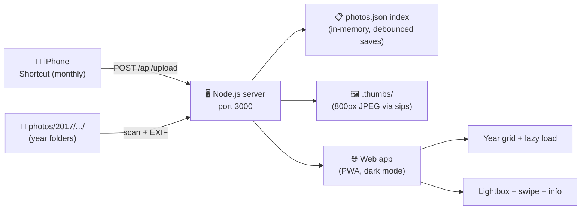

# my-gallery

**my-gallery** is a self-hosted photo library with yearly albums, an Apple Photos–style web UI, and monthly iPhone backup — zero dependencies, just Node.js.

Repository: https://github.com/rusuraluca/my-gallery

## What it does



- Photos and videos stored as plain folders by year (`photos/2017/`, `photos/2018/`, …)
- Server reads EXIF dates, builds a searchable index, generates thumbnails
- Photos and videos (`.mp4 .mov .m4v .avi .mkv .gif`) — videos get a poster frame and play in the lightbox
- Web app looks and feels like Apple Photos: year sidebar, masonry grid, lightbox, info panel, dark mode
- Installable as a PWA on iPhone ("Add to Home Screen")
- Upload from browser (drag & drop) or from iPhone via a monthly iOS Shortcut
- Download a single photo, or the **whole year as a ZIP**
- In-app toasts for uploads, scans, deletes, and downloads
- **Select mode**: tick many photos, then **delete** them in one request or **download** them as a ZIP
- **Zero npm dependencies** — runs with `node server.js` and nothing else

## Quick start

```bash
git clone https://github.com/rusuraluca/my-gallery.git
cd my-gallery
node server.js
```

| Where | URL |
|-------|-----|
| This Mac | http://localhost:3000 |
| iPhone (same WiFi) | http://YOUR_MAC_IP:3000 |

Drop photos into `photos/2024/` (any year folder), then hit **Rescan** in the sidebar — or upload directly through the web app.

```bash
# first run also scans automatically
node server.js
# → Scanning 0 image files...
# → Photos running at http://localhost:3000
```

## iPhone as a PWA

1. Open `http://YOUR_MAC_IP:3000` in Safari on your iPhone
2. Tap **Share** → **Add to Home Screen**
3. It now opens fullscreen with its own icon — no App Store needed

## Monthly iPhone backup (iOS Shortcut)

A Shortcuts automation grabs new photos from your camera roll each month and POSTs them to the server.


Full step-by-step: [ios-shortcut.md](ios-shortcut.md)

## How it stores photos

```
my-gallery/
├── photos/              ← your photos, plain folders by year
│   ├── 2012/
│   │   ├── 015.JPG
│   │   └── ...
│   └── 2017/
├── photos.json          ← index (generated, don't edit)
└── .thumbs/             ← 800px thumbnails (generated)
```

No database server. No container. Your photos are just files you can open in Finder anytime.

Paths in `photos.json` are stored **relative to the project root**, so you can move or rename the
folder freely — just run `node server.js` again and the index repairs itself (stale and duplicate
entries are pruned automatically).

## Performance at scale

| Bottleneck | What happens at scale | How it's fixed |
|---|---|---|
| Index saves | Writing `photos.json` on every photo = slow scan | Debounced batch saves (flush every 2s + on exit) |
| Grid loading | Full-res images in grid = huge memory | 800px thumbnails via macOS `sips` (`qlmanage` for video posters), HTTP caching |
| Instant scroll | Loading 3,000 images up front = stalled first paint | Tiles are laid out at once (correct page height), but image bytes arrive as they near the viewport with a 1200px look-ahead |
| Masonry | Varied aspect ratios in a fixed grid = heavy crops | Row-span masonry: each tile reserves space from its real ratio |
| Masonry relayout | Re-measuring every tile per image = thousands of forced reflows | Column width read once; only the tile that just decoded is re-spanned |
| File lookup | Linear scan of index = slow | `Set` for O(1) filepath lookups |
| ZIP export | One big buffer = memory blowup | Streaming writer (`lib/zip.js`) — never holds a whole file in memory |

**Tested comfortably:** ~50,000 photos. Beyond that, swap `photos.json` for SQLite (the `lib/db.js` interface is designed so you can).

## Project structure

| Path | Role |
|------|------|
| `server.js` | HTTP server, API routes, file serving |
| `lib/db.js` | JSON index with debounced saves |
| `lib/scanner.js` | Walks `photos/`, reads EXIF, generates thumbs |
| `lib/exif.js` | Pure JS JPEG date parser (zero deps) |
| `lib/thumbnails.js` | Thumbnails via `sips`, video posters via `qlmanage` |
| `lib/zip.js` | Streaming ZIP writer (zero deps) |
| `public/` | Web app (HTML/CSS/JS, no framework) |
| `ios-shortcut.md` | iPhone monthly backup setup |

## API

| Method | Endpoint | What it does |
|--------|----------|--------------|
| GET | `/api/years` | List years with photo counts |
| GET | `/api/photos?year=2017&page=1&limit=100` | Paginated photos |
| GET | `/api/photo/:id/thumb` | 800px thumbnail (poster frame for videos) |
| GET | `/api/photo/:id/full` | Original file (supports HTTP range) |
| GET | `/api/photo/:id/download` | Original file as an attachment |
| GET | `/api/year/:year/zip` | Whole year as a streamed ZIP |
| GET | `/api/photos/zip?ids=a,b,c` | Selection as a streamed ZIP (ids in the query, so the browser downloads it straight to disk) |
| DELETE | `/api/photo/:id` | Remove from index, delete file + thumbnail |
| POST | `/api/photos/delete` | Bulk delete `{"ids":[...]}` — one index pass, files unlinked concurrently |
| POST | `/api/upload?filename=IMG_0001.jpg` | Upload (raw body) |
| POST | `/api/scan` | Rescan `photos/` folder |

## License

MIT

## Year switching & scrolling

When you click a year in the sidebar, the app **preloads the first 48 tiles** immediately (enough to fill the viewport) and **appends more in chunks of 48** as you scroll within 1200px of the bottom. This keeps year switches instant even for large albums (thousands of photos) without sacrificing correct layout or scrollbar behavior.
