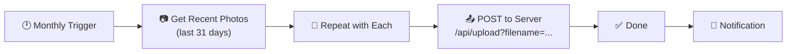

# Monthly Photo Backup — iOS Shortcut

This shortcut runs automatically every month and uploads new photos from your iPhone camera roll to your Photos server.

## How the shortcut works



## Setup (5 minutes)

### 1. Find your server's IP

On your Mac, the server prints it on startup:

```
Photos running:
→ http://localhost:3000
→ http://<your-mac-ip>:3000  (your iPhone)   ← use this one
```

> The Mac's IP is printed when the server starts. It can change — re-run
> `node server.js` to see the current one, or check **System Settings → Wi-Fi → Details → IP Address**.

### 2. Create the Shortcut

Open the **Shortcuts** app on your iPhone → tap **+** to create a new shortcut.

**Add these actions in order:**

| # | Action | Settings |
|---|--------|----------|
| 1 | **Get Recent Photos** | Count: `50`, Filter: Last `31` Days |
| 2 | **Repeat with Each** | (wraps around the rest) |
| 3 | ↳ **Get Contents of URL** | See table below |
| 4 | **Show Notification** | Text: `Photo uploaded: `[Repeat Item`]` |

**Action 3 settings (Get Contents of URL):**

| Field | Value |
|-------|-------|
| URL | `http://YOUR_IP:3000/api/upload?filename=[Repeat Item's Name]` |
| Method | `POST` |
| Request Body | `File` |
| File | `Repeat Item` |

> Replace `YOUR_IP` with your Mac's IP (the one printed at server startup).

### 3. Make it automatic

1. In Shortcuts, tap the **Automation** tab (bottom)
2. Tap **+** → **Create Personal Automation**
3. Choose **Time of Month** → set to the 1st of each month
4. Tap **Next** → add action **Run Shortcut**
5. Select the shortcut you just created
6. **Turn off** "Ask Before Running"
7. Tap **Done**

### 4. Test it

Tap your shortcut in the Shortcuts app to run it manually once. You should see the notification and the photos should appear in your web app.

## One-time setup on your Mac

Make sure the server is running and reachable:

```bash
cd my-gallery
node server.js
```

Keep it running (or run it as a background service with `pm2`, `launchd`, etc.).

## Troubleshooting

| Problem | Fix |
|---------|-----|
| Shortcut says "connection refused" | Server not running, or wrong IP. Check both. |
| Photos go to wrong year | The server reads EXIF date automatically — photos land in the right year folder. |
| Shortcut runs but no notification | Check that "Show Notification" action is the last step inside the Repeat loop. |
| Want to limit to Favorites only | In action 1, add Filter → `Is Favorite` |
